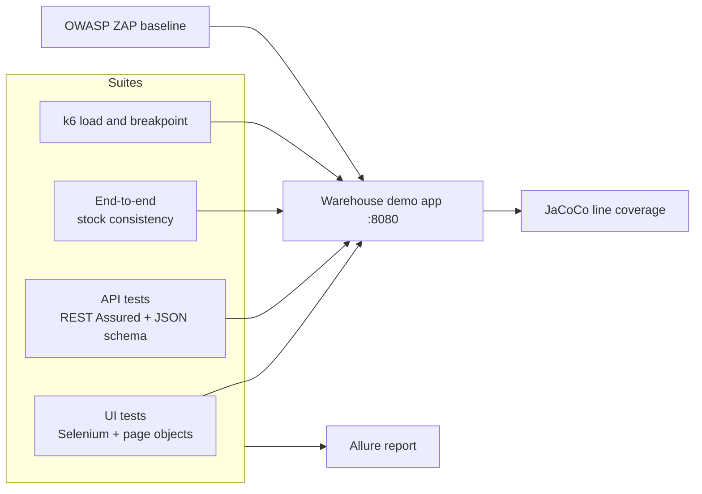

# Warehouse Quality Suite

A warehouse inventory web app plus a complete automated test framework for it.

| Part | What it is |
|---|---|
| `src/main` | The app under test: REST API and single-page UI (plain Java, no libraries, in-memory data) |
| UI tests | Selenium + Java + TestNG, Page Object Model, data-driven, parallel |
| API tests | REST Assured: auth, CRUD, JSON schema, transfers, counts, purchase orders, alerts, audit, permissions |
| End-to-end | Same stock checked in the UI and in the API |
| Reports | Allure (steps, request/response logs, failure screenshots) |
| Load test | `k6/load-test.js` with pass/fail thresholds |
| CI | `Jenkinsfile` (API, k6 and UI stages) |

## Warehouse model
- **Stock per bin:** each item holds quantity in one or more bin locations (for example A-01: 20, E-09: 5).
- **Receive / pick:** without a bin, picks drain the first bin, then the next (pick order).
- **Transfer:** moves stock between bins; the total never changes.
- **Stock count (admin):** sets the counted quantity for a bin; a reason is required.
- **Purchase orders:** create (admin), then receive in parts. Status goes OPEN, PARTIAL, RECEIVED.
- **Reorder alerts:** an item below its reorder level (default 10) is listed with a suggested order.
- **Audit trail:** every change is logged with the user, time, bin and quantity.

## Roles
| Action | Admin | Picker |
|---|---|---|
| View, search, receive, pick, transfer | yes | yes |
| Add item | yes | yes |
| Stock count (adjust) | yes | no (403) |
| Delete item | yes | no (403) |
| Create purchase order | yes | no (403) |
| Receive purchase order | yes | yes |

## Requirements
JDK 25+, Maven 3.9+, Google Chrome. In VS Code install the Extension Pack for Java.

## 1. Run the app
    mvn compile exec:java
Open http://localhost:8080 and log in as `admin / admin123` or `picker / picker123`.
Another port: `mvn compile exec:java "-Dport=8099"`.

## 2. Run the tests (keep the app running in a second terminal for best results)
    mvn clean test "-Dheadless=true"                     # all tests
    mvn clean test "-Dheadless=true" "-DsuiteFile=testng-api.xml"   # API only
    mvn clean test "-Dheadless=true" "-DsuiteFile=testng-ui.xml"    # UI and end-to-end only
The suite starts the app itself if port 8080 is free.

## 3. Report
    allure serve target/allure-results

## 4. Load test (app running)
    k6 run k6/load-test.js

## Demo data
SKU-1001 Pallet Jack (A-01: 20, E-09: 5), SKU-1002 Barcode Scanner (B-02: 40),
SKU-1003 Shrink Wrap Roll (C-03: 120), SKU-1004 Forklift Battery (D-04: 6, low stock).
`POST /api/test/reset` restores it.

## API
| Method | Path | Notes |
|---|---|---|
| POST | /api/login | returns token and role |
| GET | /api/items?q= | search by SKU or name |
| POST | /api/items | sku, name, quantity, location |
| GET / DELETE | /api/items/{sku} | DELETE is admin only |
| POST | /api/items/{sku}/receive | quantity, optional location |
| POST | /api/items/{sku}/pick | quantity, optional location |
| POST | /api/items/{sku}/transfer | from, to, quantity |
| POST | /api/items/{sku}/adjust | admin: location, quantity, reason |
| GET | /api/items/{sku}/history | newest first |
| GET | /api/alerts | items below reorder level |
| GET / POST | /api/purchase-orders | POST is admin: supplier, sku, quantity, location |
| POST | /api/purchase-orders/{id}/receive | quantity, optional location |
| GET | /api/audit?limit= | newest first |

## Layout
    src/main/java/com/ganesna/wms     app: WarehouseApp, ApiHandler, InventoryStore, Item, Event, PurchaseOrder, Json
    src/main/resources/static/index.html   UI
    src/test/java/com/ganesna/wms
      base/      DriverFactory, BaseUiTest, AppLifecycleListener
      pages/     LoginPage, InventoryPage
      support/   ApiClient
      tests/ui/  LoginUiTests, InventoryUiTests, WorkflowUiTests
      tests/api/ WarehouseApiTests, StockMovementApiTests, AdjustmentApiTests,
                 PurchaseOrderApiTests, AlertsAndAuditApiTests
      tests/e2e/ StockConsistencyTests

## Next
- MySQL in Docker, so data survives restarts and tests can check the database
- Jenkins running in Docker (the `Jenkinsfile` with API, k6 and UI stages is already in the repo)
- UI tests against Selenium Grid in Docker
- Extra load-test scenarios

## Added in this round
- **Sales orders and shipping:** `POST /api/sales-orders` reserves stock; `POST /api/sales-orders/{id}/ship` ships it (OPEN, PARTIAL, SHIPPED).
- **Reservations:** stock held by open sales orders cannot be over-promised or picked.
- **Bin capacity:** `PUT /api/locations/{bin}/capacity` (admin). Receiving, transferring or counting into a full bin returns 409. `GET /api/locations` shows capacity and usage.
- **Concurrency safe:** parallel picks and orders can never oversell or exceed capacity.
- **Idempotent requests:** send an `Idempotency-Key` header on any POST; a repeated request with the same key replays the first reply and is applied once.
- **Consistent errors:** every error returns `{"status": 409, "error": "message"}`.

## UI (this round)
- **Sales orders panel:** create an order, see its status, ship it in parts.
- **Reserved column:** units promised to open sales orders, per item.
- **Bin capacity panel (admin):** set a limit per bin and see usage bars.
- **Scan field:** type or scan a SKU and press Enter to highlight the row and focus its quantity box.
- **Reports:** activity by day and top-moving items, built from the audit trail.

## Expiry and cycle counts (this round)
- **Batches and expiry:** receive or create stock with `batch` and `expiry` (YYYY-MM-DD). `GET /api/items/{sku}/lots` lists batches with status OK, EXPIRING, EXPIRED or NO_EXPIRY.
- **Earliest expiry first:** picks, shipments and transfers use the earliest expiry first, across bins.
- **Expired stock is blocked:** it still counts toward the total but cannot be picked, shipped or transferred.
- **Expiring list:** `GET /api/expiring?days=30` shows batches that are expired or due soon.
- **Cycle counts:** `POST /api/counts` snapshots the bins; `POST /api/counts/{id}/lines` records counted quantities; `POST /api/counts/{id}/submit` locks the count; `POST /api/counts/{id}/approve` (admin) applies the variances. Approval is all-or-nothing.

## Round 3
- **Managed suppliers and customers:** `GET/POST /api/suppliers` and `/api/customers` (adding is admin only). Purchase and sales orders must name a managed party, matched without regard to case. Seeded: suppliers Acme, Acme Supply; customers Shop Ltd, Shop, Shop Co.
- **CSV import:** `POST /api/items/import` with a text body. Header: `sku,name,quantity,location,batch,expiry`. Every row is checked; one bad row rejects the file and lists each error with its line number. Fields cannot contain commas.
- **Contract tests:** every response type is checked against a JSON schema in `src/test/resources/schemas`.
- **Validation tests:** one case per validated field (`ValidationApiTests`).

## Breakpoint test results (k6)

Profile: stepped ramp from 250 to 2,000 iterations/s over 2m30s (up to 800 VUs), run with
`k6 run -e PROFILE=breakpoint k6/load-test.js` on a single laptop (k6 and the app share the
machine, so the numbers are conservative). Raw summary: `docs/k6/breakpoint-result.json`.

| | Default JDK HttpServer | With maxIdleConnections=5000 |
|---|---|---|
| Throughput | ~440-600 req/s | ~1,744 req/s |
| Failed requests | 2.6-7.4% (connection refused, EOF) | 0.00% |
| p95 latency | 0.7-2.0 s | 565 ms |

Finding: the request handlers were never the bottleneck (thread dumps showed no blocked threads
and an idle 64-thread pool). The JDK built-in server closes idle keep-alive connections above
`sun.net.httpserver.maxIdleConnections` (default 200), which caused the refused connections and
EOFs under 800 VUs. `WarehouseApp` now raises the limit to 5,000.
Remaining limit: ~1,750 req/s on this machine; the 2,000 iters/s target is not reached (79k
dropped iterations) because of the 64-thread pool and CPU shared with k6.

## Data-driven tests

`DataDrivenStockApiTests` runs the same test method over rows in CSV files, so new cases need
no Java changes:

- `src/test/resources/testdata/stock-movements.csv`: receive/pick boundaries (zero, negative,
  exact stock, over-pick) and the expected quantity afterwards.
- `src/test/resources/testdata/adjust-counts.csv`: stock counts up/down/to zero, the audit-trail
  delta and note, and rejection of negative counts.

Lines starting with `#` are comments. Rows marked `REJECTED` must return a 4xx and leave the
stock unchanged.

Current status: 169 tests (API, UI and end-to-end), 0 failures.

## 5. Run in Docker

    docker compose up -d warehouse-app                         # app on http://localhost:8080
    mvn test "-DsuiteFile=testng-api.xml"                      # API tests against the container
    docker compose --profile load run --rm k6                  # k6 load test inside Docker
    docker compose down

The suite uses the app already running on port 8080 instead of starting its own.

## CI (Jenkins)

`Jenkinsfile` runs the API tests, a k6 load test (the 50 s `load` profile with pass/fail
thresholds), then the UI and end-to-end tests. JUnit results, Allure results, the k6 summary
and the app log are archived. The agent needs JDK 25, Maven, Chrome, k6 and curl.

## Status

169 tests (API, UI and end-to-end), 0 failures. API suite also verified against the Docker
container (144 tests). k6 `load` profile passes inside Docker (0.00% failed, p95 21 ms).

## CI, quality gates and tooling

How the pieces fit together:

| Check | Run locally | In CI |
|---|---|---|
| API suite + line coverage | `mvn -Pci,api verify` (report: `target/site/jacoco/index.html`) | `ci.yml`, job *API tests + coverage* |
| UI + end-to-end suite | `mvn -Pci,ui test` | `ci.yml`, job *UI + end-to-end tests* |
| Allure report | `allure serve target/allure-results` | published to GitHub Pages from `main` |
| Security baseline (OWASP ZAP) | `docker compose up -d --build --wait warehouse-app` then `docker compose --profile security run --rm zap` (report in `docs/security`) | `ci.yml`, job *OWASP ZAP baseline scan* |
| Flaky-test check | n/a | `nightly-flaky.yml` runs the full regression 3 times each week and lists tests whose result changed or needed a retry |
| Mutation testing (experimental) | `mvn -Ppit test-compile org.pitest:pitest-maven:mutationCoverage` | not in CI |

Coverage is measured on the demo app (`src/main`) while the API suite runs. The build reports the figure and compares it with
`jacoco.min.line`; set `-Djacoco.halt=true` to make a drop below the threshold fail the build.

The accounts used by the tests (`admin` / `admin123`, `picker` / `picker123`) belong to the in-memory demo app and are public on purpose.